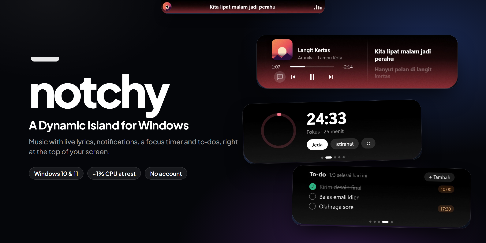
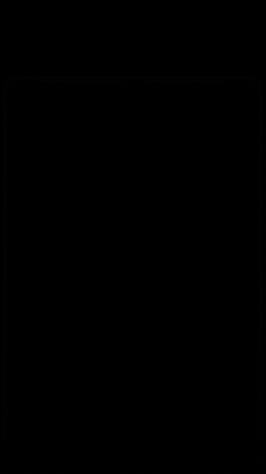
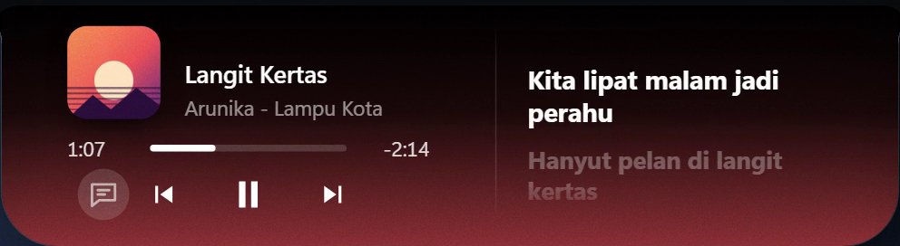
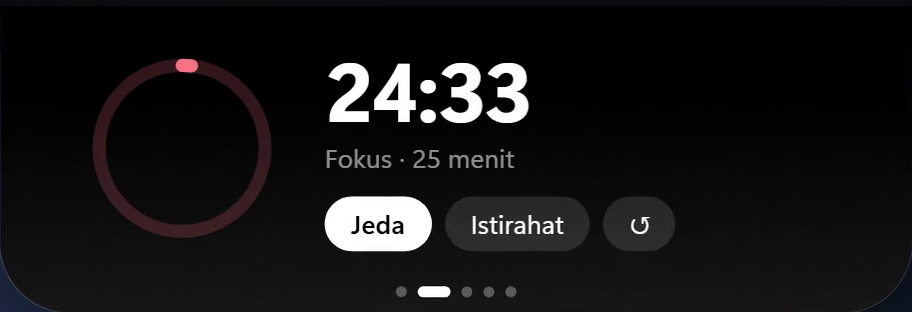
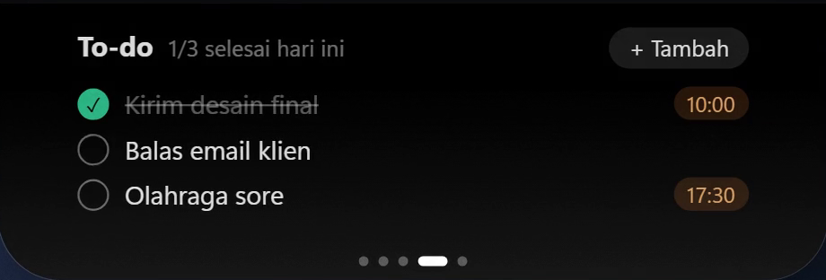
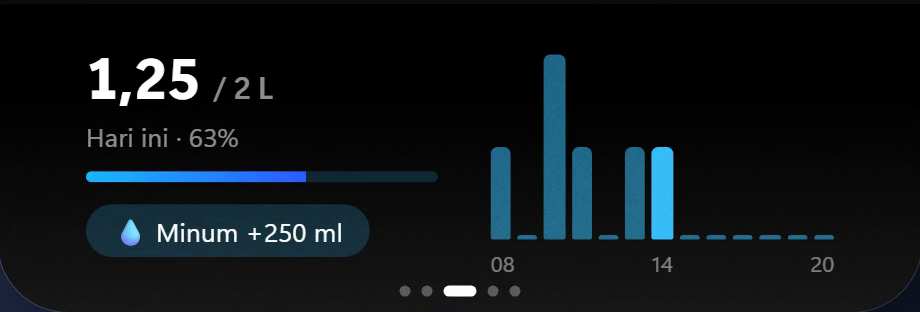

<p align="center">
  
</p>

<p align="center">
  <a href="https://github.com/RamantyaDS/Notchy/releases/latest"></a>
  
  
  <a href="https://github.com/RamantyaDS/Notchy/releases"></a>
</p>

<p align="center"><b>Your Windows laptop doesn't have a notch? Now it does.</b><br/>
A small black island at the top of your screen that shows what's happening (music, lyrics, notifications, timers) and grows when you hover it.</p>

<p align="center">
  <a href="https://github.com/RamantyaDS/Notchy/releases/latest"><b>⬇️ Download for Windows</b></a>
</p>

---

<table>
<tr>
<td width="38%" valign="top"></td>
<td valign="top">

### What it does

🎵 **Music from any player.** Spotify, YouTube in the browser, anything that shows up in Windows' media controls. Cover, progress, play/pause/skip, and the cover's color tints the notch.

🎤 **Live lyrics.** Synced lyrics appear line by line, even in the small notch while you work.

🔔 **Notifications, in the notch.** WhatsApp, Teams, Outlook… mirrored within half a second. Click one and it opens *that* chat or email, just like the real notification.

⏱️ **Focus timer**, 💧 **water reminder**, ✅ **to-do list** with reminders, 📁 **Shelf** to park files you'll drag somewhere else, 📅 **calendar** reminders from your calendar link.

🔊 **Quick status:** volume, brightness, Caps Lock, keyboard language, charging, Wi-Fi, headphones, camera and mic in use, mic mute, screenshot preview, weather, one-click audio output switch.

🫥 **Stays out of the way.** It tucks into a thin line when there's a tab or button right under it, hides for full-screen video and games, and dozes off when you're idle.

</td>
</tr>
</table>

<p align="center">
  
  
  
  
</p>

## Install

1. Download `Notchy_x.y.z_x64-setup.exe` from the [latest release](https://github.com/RamantyaDS/Notchy/releases/latest). Only download it from there.
2. Run it. Windows may warn you, because Notchy is new and not code-signed:
   - **In the browser** (*"isn't commonly downloaded"*): open your downloads, click **…** next to the file → **Keep** → **Show more** → **Keep anyway**.
   - **When you open it** (*"Windows protected your PC"*): click **More info** → **Run anyway**.
3. That's it. No admin rights, no account. Notchy **updates itself** from now on.

**Tip:** turn on Windows' *Do not disturb* (there's a button in Notchy's Settings) so notifications pop up only in the notch, not twice.

<details>
<summary>Check that your download is the real one</summary>

Every release page lists the installer's **SHA-256** fingerprint. In PowerShell:

```bash
Get-FileHash .\Notchy_x.y.z_x64-setup.exe -Algorithm SHA256
```

If the hash doesn't match the one on the release page, don't run the file.
</details>

## FAQ

<details><summary>How do I update?</summary>

You don't have to: Notchy checks when it starts, every hour and after your laptop wakes up, then installs the new version. To check right now, right-click the tray icon → **Cek update**.
</details>

<details><summary>Notifications show up twice</summary>

Windows still shows its own banner. Turn on **Do not disturb** (Settings → Notifications, or the button in Notchy's Settings); notifications then appear only in the notch and still land in the notification center.
</details>

<details><summary>A song has no lyrics, or the lyrics are off</summary>

Lyrics come from [LRCLIB](https://lrclib.net), a free community database. Some songs aren't there yet, and versions with a different length (live, remix) may not line up.
</details>

<details><summary>Which music players work?</summary>

Anything that shows up in Windows' media controls (the box above the volume slider): Spotify, YouTube and other sites in Edge/Chrome, Apple Music, the Media Player app and more.
</details>

<details><summary>My laptop has a thick top bezel / I don't like the eyes</summary>

Right-click the tray icon: **Notch minimal** turns the idle notch into a thin black line, and **Mata (maskot)** turns the eyes off. Things like music, alerts and hover still work.
</details>

<details><summary>How do I quit, or stop it starting with Windows?</summary>

Right-click the tray icon → **Exit**, or untick **Start with Windows**. Uninstall anytime from Windows Settings → Apps.
</details>

<details><summary>My antivirus flagged it</summary>

New, unsigned apps sometimes get flagged. Check the SHA-256 against the release page (above). Notchy listens only for volume, brightness, Caps Lock and language keys to show their overlays; it never records what you type.
</details>

## Feedback

Found a bug or have an idea? [Open an issue](https://github.com/RamantyaDS/Notchy/issues/new). If something went wrong, attaching `%APPDATA%\Notchy\notchy.log` helps a lot (it only has start/stop times and errors).

## Light and private

- **~1–2% CPU at rest**, a few % while music animates.
- **No account, no analytics.** Your to-dos, water log and settings stay in `%APPDATA%\Notchy`.
- It only goes online for lyrics ([LRCLIB](https://lrclib.net)), weather ([Open-Meteo](https://open-meteo.com)), your own calendar link if you add one, and checking for updates here on GitHub.

## Built with

[Tauri 2](https://tauri.app) · Rust ([windows-rs](https://github.com/microsoft/windows-rs)) for everything that talks to Windows · [Svelte 5](https://svelte.dev) for the notch itself · WebView2.

<details>
<summary>Build it yourself</summary>

Needs [Node.js](https://nodejs.org), [Rust](https://rustup.rs) and the MSVC build tools.

```bash
npm install
npm run tauri dev      # run with hot reload
npm run tauri build    # installer in src-tauri/target/release/bundle/nsis
```

Design notes and every decision behind the app are in [`notchy.md`](notchy.md) (in Indonesian).
</details>

---

<details>
<summary>🇮🇩 Bahasa Indonesia</summary>

**Laptop Windows-mu nggak punya notch? Sekarang punya.** Notchy adalah pulau hitam kecil di atas layar yang menampilkan musik beserta lirik yang ikut jalan, notifikasi (klik langsung membuka chat-nya), timer fokus, pengingat minum, to-do, Shelf file, kalender, dan status sistem. Membesar saat di-hover, menyingkir saat menghalangi.

Unduh installer di [Releases](https://github.com/RamantyaDS/Notchy/releases/latest). Kalau muncul peringatan SmartScreen, klik **More info → Run anyway**. Setelah terpasang, Notchy update sendiri. Data tetap di laptopmu, tanpa akun.

Ada bug atau ide? [Buat issue](https://github.com/RamantyaDS/Notchy/issues/new), dan kalau bisa lampirkan `%APPDATA%\Notchy\notchy.log`.
</details>
