<p align="center">
  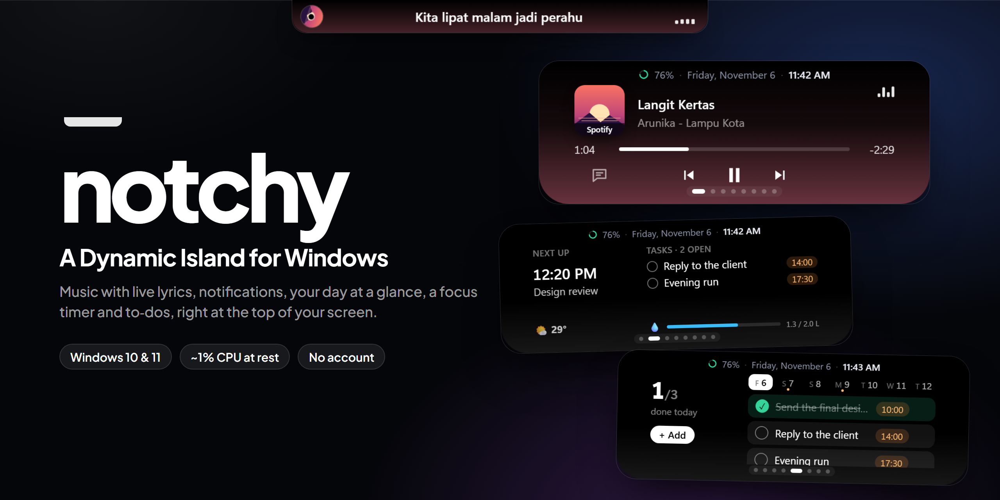
</p>

<p align="center">
  <a href="https://github.com/RamantyaDS/Notchy/releases/latest"></a>
  <a href="https://ramantyads.github.io/Notchy/"></a>
  
  
  <a href="https://github.com/RamantyaDS/Notchy/releases"></a>
</p>

<p align="center"><b>Your Windows laptop doesn't have a notch? Now it does.</b><br/>
A small black island at the top of your screen that shows what's happening (music, lyrics, notifications, timers) and grows when you hover it.</p>

<p align="center">
  <a href="https://github.com/RamantyaDS/Notchy/releases/latest"><b>⬇️ Download for Windows</b></a> &nbsp;·&nbsp;
  <a href="https://ramantyads.github.io/Notchy/"><b>🌐 Interactive Website & Demo</b></a>
</p>

> **New in 0.3:** AI coding assistant status · per-app volume · screen text OCR · rain alerts · keep-awake · keyboard-cleaning lock · countdowns · snippets · teleprompter · `notchy --peek` for custom scripts.

---

<table>
<tr>
<td width="38%" valign="top">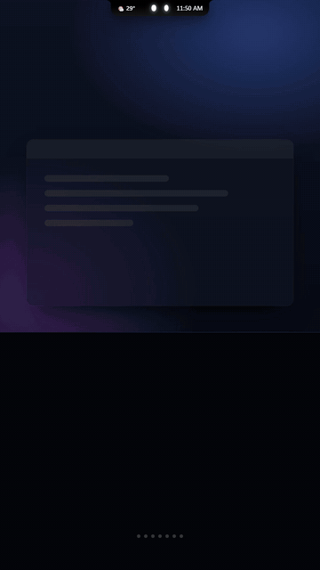</td>
<td valign="top">

### What it does

**Media and audio:** Works with Spotify, browser YouTube, and anything exposed to Windows media controls. Displays album artwork, synced lyrics line by line, live audio visualizer bars, and per-app volume sliders with mute buttons. Two players active? Click the album art to toggle between them.

**Notifications, calls, and meetings:** Mirrors WhatsApp, Teams, Outlook, and other desktop notifications within half a second; clicking one opens that exact chat or message. Displays call status pills with quick mic mute for Teams, WhatsApp, Zoom, and Meet, plus calendar meeting alerts with camera preview checks and direct Join links.

**Coding assistants and AI agents:** Monitors Antigravity, OpenAI Codex, OpenCode, Claude Code, Cursor, and custom scripts. The notch pulses while your AI works, alerts you when approval is required, and flashes a gentle green peek when finished.

**Daily productivity:** Focus timer with quick presets (1 to 15 minutes), hydration reminders with daily goal tracking, to-do lists with weekly planning strips, today's schedule, countdowns, and offline prayer times calculation (Kemenag RI, MWL, and others) with gentle chime notifications.

**Desktop utilities:** Temporary file shelf for drag-and-drop sharing, clipboard history for text and images (skipping password managers), customizable snippets, teleprompter aligned right under your webcam, offline OCR text copy from screen clips, and system shortcuts (sleep, lock screen, keep-awake, and keyboard-cleaning lock).

**System indicators and gestures:** Quick alerts for volume, brightness, battery, charging state, Caps Lock, Wi-Fi, Bluetooth peripherals, and live network speed. Control volume by scrolling on the closed notch, swipe horizontally to skip tracks, or press **Ctrl+Alt+N** to navigate pages via keyboard.

**Appearance and behavior:** Five eye mascot styles (Classic, Anime, Pixel, Cat, and Cartoon) with real-time gaze tracking, winks, and startle reactions. Choose between an edge-docked notch or floating island pill, add secondary status rings, configure multi-monitor placement, and switch between English and Indonesian. The notch stays tucked when you need screen space and hides during full-screen games or video.

</td>
</tr>
</table>

<p align="center">
  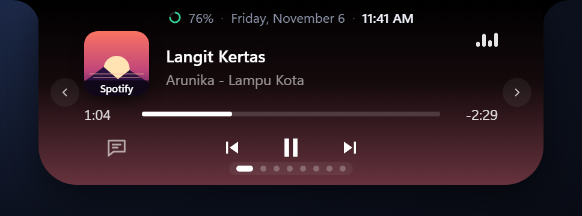
  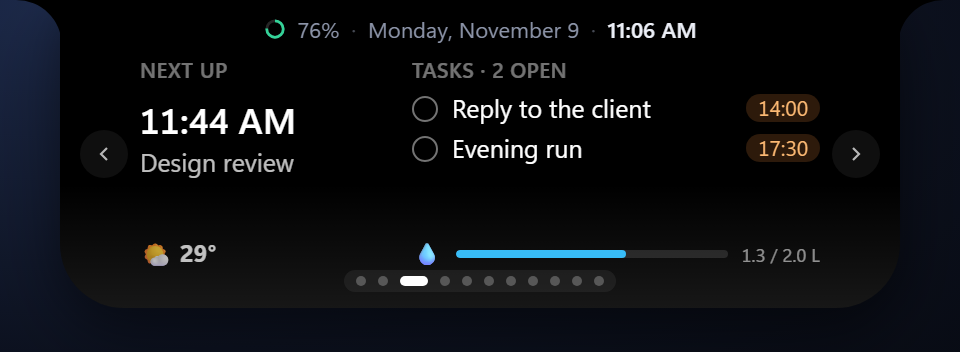
  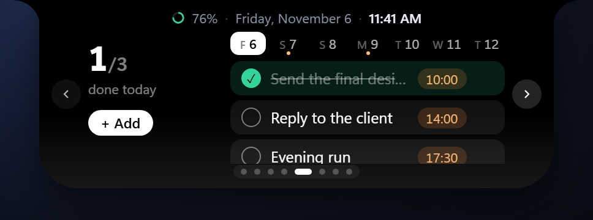
  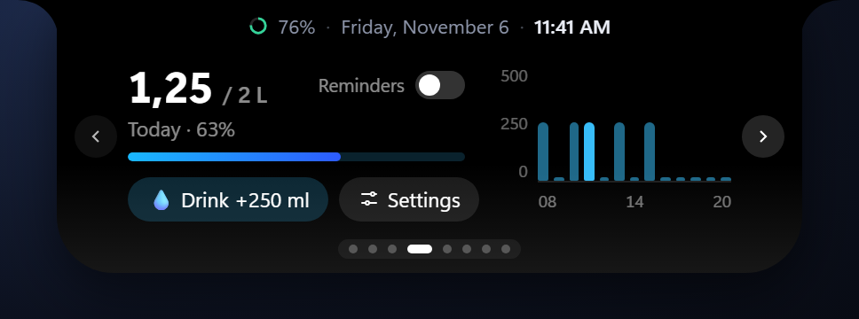
</p>

<p align="center">
  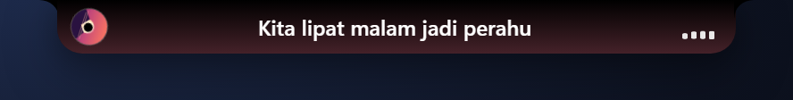
  
</p>

<p align="center">
  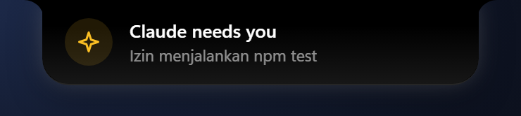
  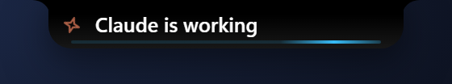
  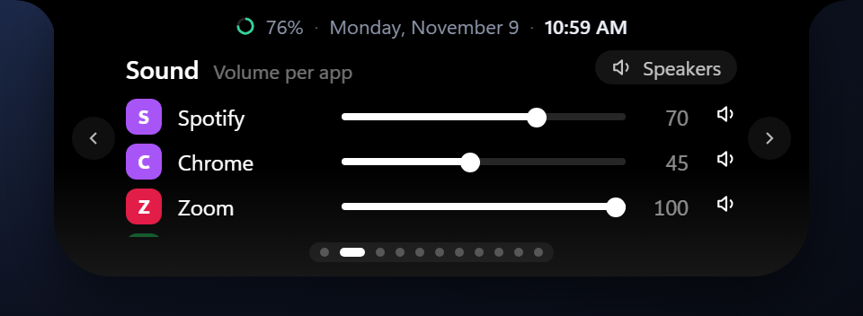
  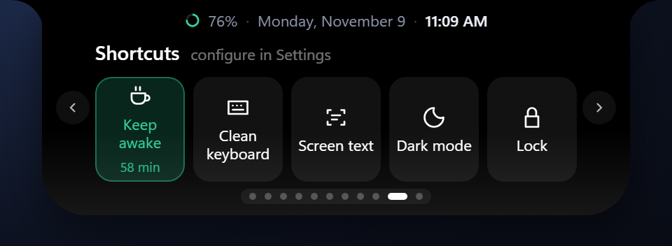
  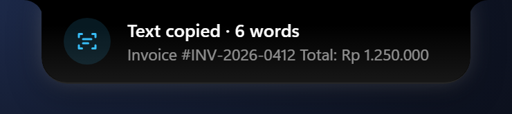
  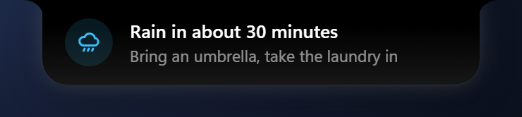
  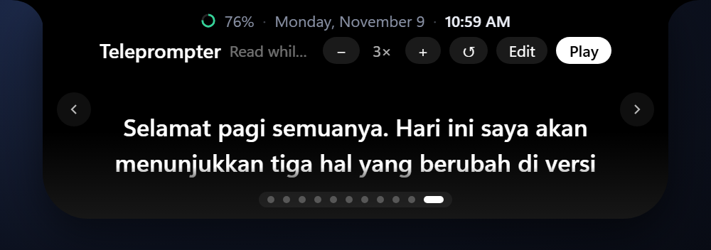
  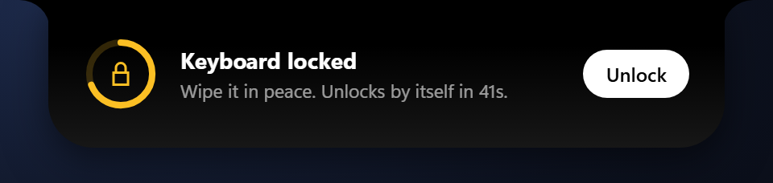
</p>

<p align="center">
  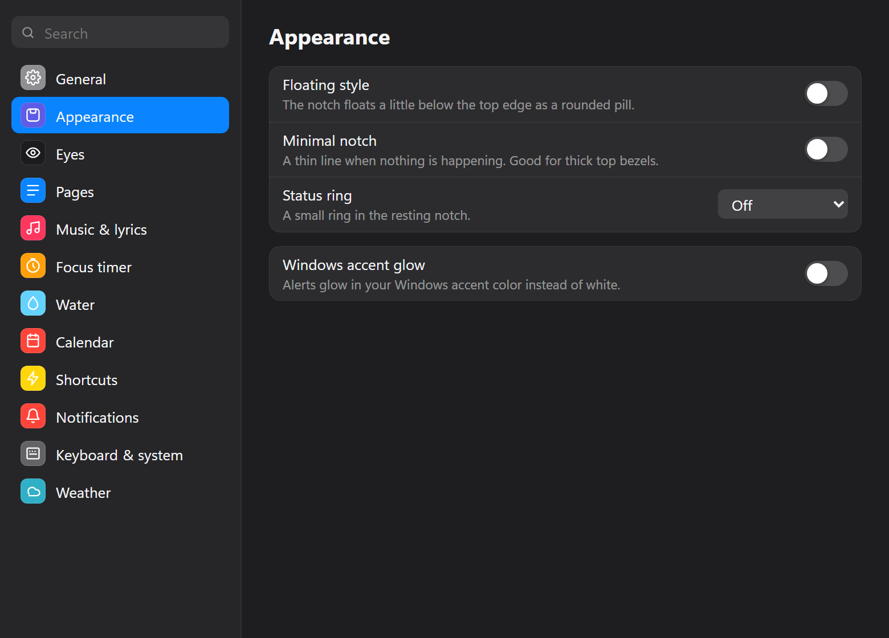
</p>

## External scripts and AI assistant integration

Anything that can run a command can put a message in the notch. Text only: nothing is ever run.

```bash
notchy --peek "Build finished" --icon done --sound
notchy --peek "Backup failed" --detail "Disk is full" --icon error
```

Icons: `done`, `error`, `info`, `bell`. There's also a link form, `notchy://peek?text=Hello&icon=info`, for apps that open URLs.

**AI Coding Assistants & Agents:** turn on *AI Assistants & Agents* in Settings → Keyboard & system. Supports Antigravity / Gemini CLI, OpenAI Codex, OpenCode, Claude Code, Cursor, Aider, or any custom script:
- **CLI flag:** `notchy --agent working | waiting | done [--app "Antigravity"] [--text "Needs approval"]`
- **URL Scheme:** `notchy://agent?app=Antigravity&state=waiting&text=Approval%20required` (location-free, callable from any terminal or script)

The notch pulses while your AI works, startles the mascot and pings you when it needs your approval, and flashes a gentle green peek when finished.

## Install

1. Download `Notchy_x.y.z_x64-setup.exe` from the [latest release](https://github.com/RamantyaDS/Notchy/releases/latest). Only download it from there.
2. Run it. Windows may warn you, because Notchy is new and not code-signed:
   - **In the browser** (*"isn't commonly downloaded"*): open your downloads, click **…** next to the file → **Keep** → **Show more** → **Keep anyway**.
   - **When you open it** (*"Windows protected your PC"*): click **More info** → **Run anyway**.
3. That's it. No admin rights, no account. Notchy **updates itself** from now on.

### Portable (no install)

Can't run installers, e.g. on a work laptop? Download `Notchy_x.y.z_x64-portable.zip` from the same release, unzip it anywhere and run `notchy.exe`. Settings and data still live in `%APPDATA%\Notchy`.

The portable copy **doesn't update itself**: when a new version is out, the notch tells you, and clicking it opens the release page. To remove it, untick **Start with Windows** in the tray menu, exit, and delete the folder.

**Tip:** turn on Windows' *Do not disturb* (there's a button in Notchy's Settings) so notifications pop up only in the notch, not twice.

<details>
<summary>Check that your download is the real one</summary>

Every release page lists the **SHA-256** fingerprint of the installer and the portable zip. In PowerShell:

```bash
Get-FileHash .\Notchy_x.y.z_x64-setup.exe -Algorithm SHA256
```

(or `.\Notchy_x.y.z_x64-portable.zip`)

If the hash doesn't match the one on the release page, don't run the file.
</details>

## FAQ

<details><summary>How do I update?</summary>

You don't have to: Notchy checks when it starts, every hour and after your laptop wakes up, then installs the new version. To check right now, right-click the tray icon → **Cek update**. The portable copy only tells you a new version is out; download the new zip from the release page.
</details>

<details><summary>The installer won't run on my work laptop</summary>

Company laptops often block programs that aren't on an approved list, with a message like *"Windows cannot access the specified device, path, or file"*. Try the **portable zip**. If that's blocked too, ask your IT team to allow Notchy; the SHA-256 on the release page lets them check the exact file.
</details>

<details><summary>Notifications show up twice</summary>

Windows still shows its own banner. Turn on **Do not disturb** (Settings → Notifications, or the button in Notchy's Settings); notifications then appear only in the notch and still land in the notification center.
</details>

<details><summary>The volume icon shows twice (Windows' and Notchy's)</summary>

Turn on **Hide Windows volume overlay** in Settings → **Keyboard & system** and restart Notchy. The volume keys are then handled by Notchy, so only its own volume peek appears. On some laptops the Fn volume keys are handled by the maker's driver, and Windows' overlay still shows there. The brightness overlay can't be hidden this way.
</details>

<details><summary>A song has no lyrics, or the lyrics are off</summary>

Lyrics come from [LRCLIB](https://lrclib.net), a free community database. Some songs aren't there yet, and versions with a different length (live, remix) may not line up.
</details>

<details><summary>Which music players work?</summary>

Anything that shows up in Windows' media controls (the box above the volume slider): Spotify, YouTube and other sites in Edge/Chrome, Apple Music, the Media Player app and more.
</details>

<details><summary>My laptop has a thick top bezel / I don't like the eyes</summary>

Right-click the tray icon: **Notch minimal** turns the idle notch into a thin black line, and **Mata (maskot)** turns the eyes off. You can also customize Notchy's look in Settings with 5 different eye styles (Classic, Anime ✨, Pixel 👾, Cat 🐱, Cartoon 👀). Things like music, alerts and hover still work.
</details>

<details><summary>"Copy text from screen" doesn't find any text</summary>

It uses Windows' own text recognition, for the languages installed in Windows (Settings → Time & language → Language). Pick a sharper or larger area; very small or stylized text may not be read.
</details>

<details><summary>Ctrl+Alt+N doesn't open the notch</summary>

Another app may already use it. Pick another one in Settings → Keyboard & system → Hotkeys, like `Ctrl+Alt+Shift+N`.
</details>

<details><summary>How do I quit, or stop it starting with Windows?</summary>

Right-click the tray icon → **Exit**, or untick **Start with Windows**. Uninstall anytime from Windows Settings → Apps.
</details>

<details><summary>My antivirus flagged it</summary>

New, unsigned apps sometimes get flagged. Check the SHA-256 against the release page (above). Notchy listens only for volume, brightness, Caps Lock and language keys to show their overlays; it never records what you type. If you'd rather it didn't watch the keyboard at all, turn off **Caps Lock & keyboard language** and **Hide Windows volume overlay** in Settings → **Keyboard & system** (applies after restarting Notchy). The keyboard-cleaning lock also needs the keyboard, so it starts watching it only once you use that lock.
</details>

## Feedback

Found a bug or have an idea? [Open an issue](https://github.com/RamantyaDS/Notchy/issues/new). If something went wrong, attaching `%APPDATA%\Notchy\notchy.log` helps a lot (it only has start/stop times and errors).

## Light and private

- **~1-2% CPU at rest**, a few % while music animates.
- **No account, no analytics.** Your to-dos, water log and settings stay in `%APPDATA%\Notchy`.
- **Careful with clicks.** Programs and scripts on the Shelf or in Downloads are shown in Explorer, never run; links from notifications open only for web, mail and the usual chat/meeting apps.
- It only goes online for lyrics ([LRCLIB](https://lrclib.net)), weather and rain alerts ([Open-Meteo](https://open-meteo.com)), your own calendar link if you add one, and checking for updates here on GitHub. Text from the screen is read on your PC, offline, and so are prayer times.

## Built with

[Tauri 2](https://tauri.app) · Rust ([windows-rs](https://github.com/microsoft/windows-rs)) for everything that talks to Windows · [Svelte 5](https://svelte.dev) for the notch itself · WebView2.

<details>
<summary>Build it yourself</summary>

Needs [Node.js](https://nodejs.org), [Rust](https://rustup.rs) and the MSVC build tools.

```bash
npm install
npm run tauri dev      # run with hot reload
npm run tauri build    # installer in src-tauri/target/release/bundle/nsis
```

Design notes and every decision behind the app are in [`notchy.md`](notchy.md) (in Indonesian).
</details>

---

<details>
<summary>🇮🇩 Bahasa Indonesia</summary>

**Laptop Windows-mu nggak punya notch? Sekarang punya.** Notchy adalah pulau hitam kecil di atas layar yang menampilkan musik beserta lirik yang ikut jalan, notifikasi (klik langsung membuka chat-nya), panggilan dan meeting (mute, cek kamera, Join), status Claude Code, volume per aplikasi, halaman Hari ini dengan hitung mundur, timer fokus dan timer cepat, pengingat minum, to-do dengan strip minggu, kalender, Shelf file, riwayat clipboard, snippet, teleprompter, progres unduhan, halaman pintasan (jaga menyala, kunci keyboard untuk dibersihkan, salin teks dari layar, mode gelap), peringatan hujan, pengingat cabut charger, istirahat mata 20-20-20, jadwal sholat offline (default mati), kecepatan internet, dan status sistem. Script apa pun bisa memunculkan pesan lewat `notchy --peek "teks"`. Mata maskot punya 5 gaya (Classic, Anime, Pixel, Cat, Cartoon) yang bisa melirik kursor, berkedip, dan berekspresi. Halaman yang tidak dipakai bisa dimatikan di Settings. Tampilan bisa bahasa Indonesia atau Inggris, notch bisa melayang sebagai pil di bawah tepi atas, dan bisa ikut pindah ke layar kedua mengikuti kursor. Membesar saat kursor berhenti di atasnya, menyingkir saat menghalangi.

Unduh installer di [Releases](https://github.com/RamantyaDS/Notchy/releases/latest) atau coba demonya langsung di [Website Notchy](https://ramantyads.github.io/Notchy/). Kalau muncul peringatan SmartScreen, klik **More info → Run anyway**. Setelah terpasang, Notchy update sendiri. Data tetap di laptopmu, tanpa akun.

Tidak bisa menjalankan installer, misalnya di laptop kantor? Unduh **`Notchy_x.y.z_x64-portable.zip`** dari rilis yang sama, ekstrak, lalu jalankan `notchy.exe`. Versi portable tidak update sendiri: kalau ada versi baru, notch memberi tahu dan klik membuka halaman rilis.

Ada bug atau ide? [Buat issue](https://github.com/RamantyaDS/Notchy/issues/new), dan kalau bisa lampirkan `%APPDATA%\Notchy\notchy.log`.
</details>
